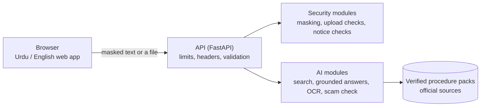

# Haqdar (حقدار)

**Your rights, in plain language.** An Urdu-first, open-source helper that explains official notices and procedures with cited sources, refuses to answer when it cannot verify, hides personal details before analysis, and checks notices for scam warning signs.


Built for the **Hacktoberfest Hackathon NUST × NSTP** by Malaika Adnan and Malaika Khan.

> Haqdar gives **information, not legal advice**. For important matters, contact the relevant office.

## Sustainable Development Goals

**SDG 16: Peace, Justice and Strong Institutions.** Haqdar turns dense official notices and procedures into plain Urdu and English, and links every step to the official source it came from. This gives people access to information that institutions already publish and makes dealing with offices more transparent. When the sources do not support an answer, Haqdar says so and points to the right office instead of guessing.

**SDG 10: Reduced Inequalities.** Official paperwork is easier for people who read English or legal language well, and harder for everyone else. Haqdar is Urdu-first, free and works on a phone, so language and literacy become a smaller barrier when dealing with utility, tax and ID offices. It can also reduce dependence on middlemen who charge for explaining a notice.

**SDG 1: No Poverty.** Disputing an electricity bill, renewing a CNIC or answering a tax notice are steps towards basic services and rights. Haqdar explains each procedure step by step, lists the documents needed, and warns about scam notices that ask for payment through wallets or gift cards. This can help people with little money to spare avoid missed deadlines and wrongful payments.

<!--
Screenshots: take these from the running app, save them in docs/screenshots/, then remove this comment.

| Ask a question | Review before sending | Notice result |
|---|---|---|
|  |  |  |
-->

## The problem

Electricity bills, tax notices, ID renewals and rental disputes in Pakistan are written in dense language. People worry about making a mistake, and scam messages copy the style of real government notices. General chatbots can invent answers, and many ask people to paste personal details.

## What Haqdar does

**1. Ask a question** in Urdu, Roman Urdu or English. You get step-by-step instructions, the documents you need, and a link to the official source for each step. If Haqdar cannot verify an answer, it says so and points you to the right office instead of guessing.

**2. Understand a notice.** Paste the text, or upload a photo (JPG or PNG), a PDF that contains real text, or a text file. Personal details are hidden, and you review the text before anything is analysed. Haqdar then shows the sender, date, deadline, amount and demand, explains the notice in plain language, lists what to do next, and checks it for scam warning signs. The verdict is *genuine*, *suspicious* or *unclear*, always with reasons, and always as "warning signs, not proof".

**3. Bilingual and installable.** The whole interface works in Urdu (right to left) and English, and you can switch at any time. It is an installable web app.

### Verified procedure packs

Every answer comes from a hand-checked pack. Each step in a pack links to the official page it was written from.

| Pack | Covers |
|---|---|
| `electricity_bill_dispute` | Disputing a high electricity bill |
| `fbr_tax_notice` | Replying to an FBR notice to file a tax return |
| `cnic_renewal` | Renewing a CNIC |
| `rent_islamabad` | Renting basics for tenants and landlords (Islamabad only) |

Haqdar can also draft complaint letters for the electricity and FBR packs through the API. These are not in the web interface yet.

## How it works



**A question:** the text is searched against the packs using meaning and keywords. If the best match is strong enough, the answer is assembled from that pack's verified steps, with sources. If not, Haqdar refuses.

**A notice:** personal details are masked, you review the text, then Haqdar extracts the key fields, checks the links and wording for warning signs, and matches the notice to a pack for next steps.

**A photo or PDF:** the file is checked, its text is read (photos with Tesseract in Urdu and English, PDFs from the text inside them), personal details are masked on the server, and the text goes to the same review screen. You can edit it before sending. A text file is read in your browser and never leaves it until you confirm.

**No outside AI service is called.** Answers are built only from the verified packs, and nothing you type or upload leaves the server.

## Privacy and security by design

| Risk | Defence |
|---|---|
| Personal details typed or pasted | Masked in the browser before sending (CNIC, phone, email, IBAN, labelled reference numbers; English and Urdu digits). Black bars show what was hidden, and you confirm before anything is sent. |
| Personal details in a photo or PDF | Masked on the server before the text is returned. You review it. Names and addresses are not masked automatically, which is why the review step exists. |
| Malicious or oversized uploads | The real file type is checked (not the file name), 8 MB limit, image size limit, metadata removed, photo rotated upright. PDFs are read only from the text inside them (first 3 pages, nothing is run or opened) and password-protected PDFs are refused. Files are read in memory and deleted. |
| Abuse and overload | 64 KB request limit (8 MB only for the upload route), rate limits per client, at most 2 files read at the same time. |
| Script injection | Text from the server is shown with `textContent`. Strict Content-Security-Policy: no inline scripts, no third-party requests. |
| Information leaks | Errors never repeat what you sent, the server banner is hidden, security headers on every response, nothing you type is stored or logged. |
| Fake notices | Official-domain list, look-alike domains, link shorteners, raw IP links, mobile-wallet or gift-card payment requests, urgent or threatening language. |
| Invented answers | Answers come only from verified pack steps, with citations, and Haqdar refuses below a confidence threshold. |
| Supply chain and deployment | CI runs code and dependency security scans and a secret scan; the container runs as a non-root user with a read-only filesystem, no extra privileges and memory limits. |

`backend/security/payload.py` contains a defence against prompt injection for a possible future language-model step. It is not used today, because no language model is called.

## Results

Evaluated by Malaika Khan on 52 questions in Urdu, Roman Urdu and English across the 4 packs ([details and method](eval/README.md)):

| | Result |
|---|:---:|
| Correct answers | **41 / 42** (98%) |
| Answers with a correct official source | **41 / 41** (100%) |
| Out-of-scope questions safely refused | **9 / 10** (90%) |
| Real questions wrongly refused | **1 / 42** (2%) |

Reading a photo of a notice, tested on synthetic notices ([details](eval/ocr_results.md)): key fields recovered exactly 74% of the time. English 91%, Roman Urdu 94%, **Urdu script only 20%**. Always check the text before sending.

## Run it

### With Docker (recommended)

```bash
git clone https://github.com/malaikamalik23/Haqdar.git
cd Haqdar
docker compose up --build
```

Then open **http://localhost:5500**. The first build downloads PyTorch (CPU version), the search model and Tesseract, so it takes a while. Each start then takes a minute or two while the search model loads. Stop with `Ctrl+C`, then `docker compose down`.

The API listens on `127.0.0.1:8000` and the web app on `127.0.0.1:5500`, so only your own computer can reach them.

### Without Docker (Python 3.11)

```bash
python -m venv .venv
# Windows: .venv\Scripts\activate      macOS/Linux: source .venv/bin/activate
pip install -r backend/requirements.txt -r backend/ai/requirements.txt
cd backend
uvicorn main:app --reload
```

In a second terminal: `cd web && python -m http.server 5500`, then open http://localhost:5500. The first start downloads the search model (about 0.5 GB). Photo reading needs [Tesseract](https://github.com/tesseract-ocr/tesseract) with the Urdu language data installed; without it, the upload box says reading photos is not available.

### Mock mode (for working on the interface)

Set `HAQDAR_AI_MODE=mock` (PowerShell: `$env:HAQDAR_AI_MODE="mock"`) before starting the API. It needs only `backend/requirements.txt` and returns fixed sample answers, so do not use it to judge answer quality.

### Questions to try

- My electricity meter is running fast, what should I do?
- I got a notice from FBR, how do I reply to it?
- How do I renew my CNIC online?
- Does my rent agreement in Islamabad need to be in writing?
- میرا میٹر تیز چل رہا ہے، کیا کروں؟
- What is the weather in Lahore? *(should be refused politely)*

On the Notice page, use **Try a sample notice**, or upload a photo, a PDF or a text file of a notice. Use made-up data only.

### Troubleshooting

- **Windows blocks PyTorch or Pillow** ("An Application Control policy has blocked this file"): this is Windows Smart App Control rejecting newly released compiled libraries. Use the Docker route, which runs on Linux. For Pillow, an older release such as `pip install "pillow==11.3.0"` usually loads.
- **"port is already allocated":** something else is using port 8000 or 5500. Stop it and run again.
- **The container is killed or keeps restarting:** give Docker at least 3 GB of memory.

## Configuration

All settings are environment variables. No API keys are needed.

| Variable | Default | Meaning |
|---|---|---|
| `HAQDAR_AI_MODE` | `real` | `real` uses the AI modules; `mock` returns sample answers |
| `HAQDAR_ENV` | `development` | `production` turns off the interactive API docs |
| `HAQDAR_ALLOWED_ORIGINS` | `http://localhost:5500,http://127.0.0.1:5500` | Web addresses allowed to call the API |
| `HAQDAR_TRUST_PROXY` | `0` | Set to `1` behind a trusted proxy, so rate limits see the real client |
| `HAQDAR_HSTS` | `0` | Set to `1` when served over HTTPS |
| `HAQDAR_RATE_WRITE` / `HAQDAR_RATE_READ` | `20` / `60` | Requests per minute per client |
| `HAQDAR_RATE_EXTRACT` | `6` | File uploads per minute per client |
| `HAQDAR_MAX_BODY_BYTES` | `65536` | Largest request body (64 KB) |
| `HAQDAR_UPLOAD_MAX_BYTES` | `8388608` | Largest uploaded file (8 MB) |
| `HAQDAR_PACKS_DIR` | `packs/` | Where the procedure packs are |
| `HAQDAR_ABSTAIN_THRESHOLD` | `0.25` | Minimum match score before Haqdar answers |
| `HAQDAR_OCR_LANGS` / `HAQDAR_TESSERACT_CMD` | `urd+eng` / auto | OCR languages and Tesseract location |

## API

| Endpoint | Purpose |
|---|---|
| `GET /health` | Is the server ready |
| `GET /procedures` | List the available packs |
| `POST /ask` | Ask a question |
| `POST /analyze` | Explain and check a notice (text) |
| `POST /extract` | Read the text from a photo or PDF of a notice, with personal details masked |
| `POST /letter` | Draft a letter for a pack that has a template |

Full request and response shapes are in [docs/api.md](docs/api.md).

## Project structure

```
backend/
  main.py        API, limits and wiring
  security/      masking, upload checks, PDF text, notice checks, HTTP guards
  ai/            pack loader, search, answers, OCR, field extraction, scam check, letters
  tests/         API and security tests
packs/           verified procedure packs (YAML)
web/             the web app (pages are generated by tools/build_pages.py)
tools/           page generator, web checker, pack validator, logo scripts
eval/            evaluation questions, results and scripts
docs/            API description, architecture, threat model, third-party licences
.github/         CI workflow and Dependabot
```

## Tests and CI

```bash
cd backend && pytest -q tests ai        # API, security and AI tests (over 200 in total with the tools)
python -m pytest tools/tests -q         # page generator, web checker, pack validator
python tools/check_web.py               # pages are consistent and safe
python tools/validate_packs.py          # packs are valid and cite official sources only
python tools/build_pages.py             # regenerate the pages after editing the generator
python eval/run_eval.py                 # re-run the answer evaluation (needs the search model)
```

GitHub Actions runs on every change: backend tests with a Bandit code scan and a pip-audit dependency scan, web checks, pack validation, a secret scan (gitleaks), and a Docker job that lints the Dockerfile, builds the image, runs it locked down and checks a real answer, a refusal, a photo read and a PDF read. An image vulnerability scan also runs and is informational. The main branch is protected: changes need a pull request and the five required checks.

## Adding a procedure pack

1. Copy an existing file in `packs/` and write the steps, documents needed and the office.
2. Every step needs a source link on an official domain from `backend/security/official_domains.json`.
3. Run `python tools/validate_packs.py`.
4. Add test questions to `eval/questions.yaml` and run `python eval/run_eval.py`. A pack is not ready until its questions are answered correctly and nearby out-of-scope questions are refused.

## Limits

- Only 4 topics, and renting covers Islamabad only. Questions about other places are refused on purpose.
- Photos of Urdu-script notices are often misread. Amounts and dates can be wrong, so always check the text.
- Scanned PDFs have no text to read: upload a photo of the page instead. Only the first 3 pages of a PDF are read.
- Photo reading was tested on synthetic notices, not on real photos.
- Names and addresses are not masked automatically.
- Official sources change. Each answer shows its sources, so check them for important matters.
- The web app needs the server to answer. Only the app shell works offline.
- No public live deployment and no voice features yet.

## Roadmap

- Letter drafting in the web interface, and letter templates for the CNIC and rent packs.
- More packs and places (other cities), each written from official sources.
- A test of photo reading on real phone photos.
- Reading answers aloud.
- A public demo.

## Team

| | Role | Work |
|---|---|---|
| **Malaika Adnan** | Security, API and web | API and its hardening, privacy and security modules, the bilingual web app, photo, PDF and text upload flow, Docker, CI, documentation |
| **Malaika Khan** | AI and data science lead | Procedure packs and sources, hybrid search, grounded answers with citations and refusal, scam-language check, OCR and field extraction, letter templates, evaluation |

## Acknowledgements

- The **Noto Nastaliq Urdu** font (SIL Open Font License) was used to draw the logo. The font file is not redistributed here; a copy of its licence is in [docs/third-party](docs/third-party/NotoNastaliqUrdu-OFL.txt).
- [Tesseract OCR](https://github.com/tesseract-ocr/tesseract), [sentence-transformers](https://www.sbert.net/) (`paraphrase-multilingual-MiniLM-L12-v2`), [FAISS](https://github.com/facebookresearch/faiss), [FastAPI](https://fastapi.tiangolo.com/), [Pillow](https://python-pillow.org/) and [pypdf](https://pypdf.readthedocs.io/).
- The official government pages cited in each pack.

## More documentation

- [Architecture](docs/architecture.md): diagrams of how the pieces fit together, and why
- [Threat model](docs/threat-model.md): what we protect, what we defend against, and the known gaps
- [Security policy](SECURITY.md): how to report a vulnerability
- [Contributing](CONTRIBUTING.md): how to set up, test and add a procedure pack
- [API](docs/api.md) and [evaluation](eval/README.md)

## Licence

[MIT](LICENSE)