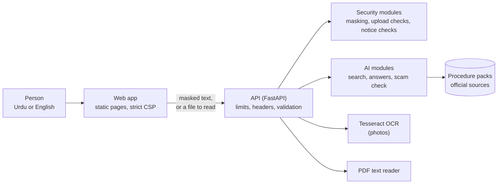
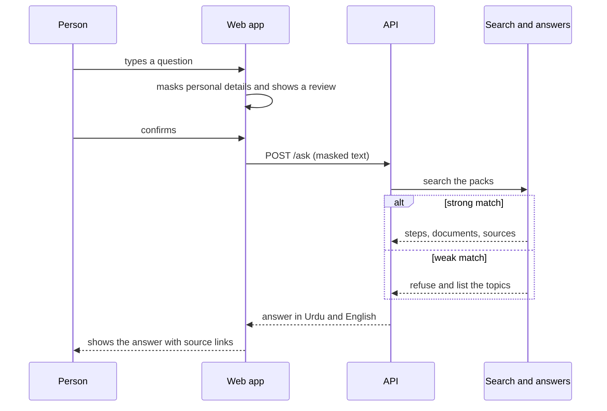
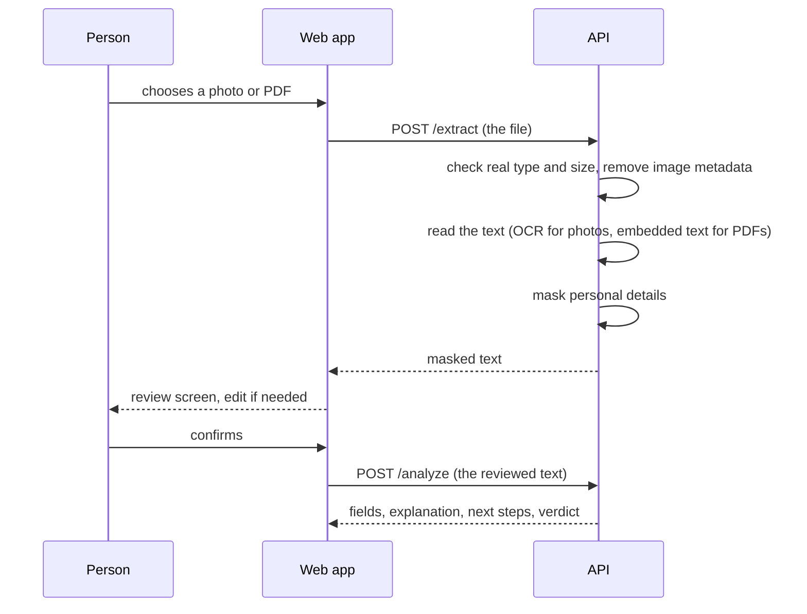
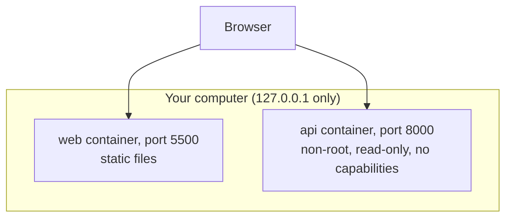

# Architecture

Haqdar has three parts: a **web app** that runs in the browser, an **API** that checks every request, and two groups of modules behind it: **security** (masking, upload checks, notice checks) and **AI** (search, grounded answers, OCR, scam check). Everything an answer says comes from **verified procedure packs**.

## The big picture

| Part | Where | What it does | Owner |
|---|---|---|---|
| Web app | `web/`, generated by `tools/build_pages.py` | Urdu and English pages, masking and review in the browser, calls the API | Malaika Adnan |
| API | `backend/main.py` | Routes, limits, security headers, strict input checks | Malaika Adnan |
| Security modules | `backend/security/` | Masking (`redact.py`), upload checks (`files.py`), PDF text (`pdf_text.py`), notice checks (`notice_check.py`), HTTP guards (`http_guard.py`) | Malaika Adnan |
| AI modules | `backend/ai/` | Pack loader, hybrid search, grounded answers with refusal, scam-language check, field extraction, OCR, letters | Malaika Khan |
| Procedure packs | `packs/` | Steps, documents and offices, each step with an official source | Malaika Khan |
| Evaluation | `eval/` | Questions and results for answers and for reading photos | Malaika Khan |
| Pipeline | `.github/`, `backend/Dockerfile`, `docker-compose.yml` | Tests, security scans, container build and checks | Malaika Adnan |

## Asking a question

Search combines meaning (a multilingual embedding model) with keywords. If the best match scores below the threshold, Haqdar refuses instead of guessing. The answer is assembled from the matching pack's steps, so it can only say what a verified source says.

## Reading a notice from a photo or PDF

Reading and analysing are two separate steps on purpose: OCR makes mistakes, so nothing is analysed until the person has seen the text. A plain text file is read in the browser and goes straight to the review screen without touching the server.

## What leaves the browser

| Goes to the server | Stays in the browser |
|---|---|
| The question or notice text after masking, or a photo or PDF the person chose | The original text before masking, the language choice, text files until review |

Nothing goes to any third party. The server keeps nothing the person typed or uploaded.

## Running it

`docker compose up --build` starts both containers. The image holds the AI modules, the packs, Tesseract and the search model, so it needs no internet once built. `HAQDAR_AI_MODE=mock` swaps the AI modules for fixed sample answers, which is useful when working on the interface.

## Decisions and why

- **Verified packs, not a language model.** Answers about money and deadlines must be traceable to an official page. A model could invent a step. A pack cannot say more than its sources.
- **Refuse instead of guess.** A wrong answer is worse than "contact the office". Refusal is measured in `eval/`.
- **Mask before sending, review before analysing.** The person sees what leaves the browser, and OCR errors are caught before they matter.
- **Mock and real modes.** The interface can be built and tested without the heavy AI libraries, and CI runs the AI tests with a small stand-in for the search model.
- **Pages are generated.** One generator keeps Urdu and English in step, and CI fails if the pages drift.
- **Model baked into the image.** The container needs no internet at run time and starts the same way every time.

## Where to extend

- **A new topic:** add a pack (see [CONTRIBUTING.md](../CONTRIBUTING.md)).
- **A new letter:** add a template in `backend/ai/templates/letters/` for a pack.
- **A new route:** add it in `backend/main.py` with its own limits and tests, and update [docs/api.md](api.md) and the [threat model](threat-model.md).
