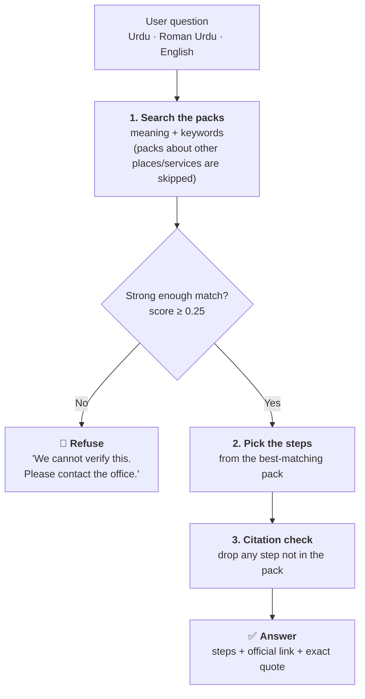

# Haqdar AI: how it works and how well it works

> **In one line:** Haqdar answers questions about official procedures **only from verified government sources**, and **refuses** when it cannot verify an answer.

**Owner:** Malaika Khan, Data Science and AI Lead
**Code:** `backend/ai/` · **Packs:** `packs/` · **Evaluation:** `eval/`

---

## Results at a glance

| | Result |
|---|:---:|
| ✅ Correct answers | **41 / 42** (98%) |
| 📎 Answers with a correct official source | **41 / 41** (100%) |
| 🛑 Out-of-scope questions safely refused | **9 / 10** (90%) |
| ⚠️ Real questions wrongly refused | **1 / 42** (2%) |

Tested in **Urdu**, **Roman Urdu** and **English** on 52 questions across 4 procedure packs. See [Limitations](#limitations) before reading too much into these numbers.

---

## How a question is answered



**Why this is safe:** Haqdar never writes its own steps. It only shows steps that already exist in a pack, and each one comes with its source. In this mode nothing is sent outside the server.

---

## The modules

| Module | What it does in plain words |
|---|---|
| **K1 · Pack loader** | Reads the procedure packs and rejects any step without a valid official source |
| **K2 · Search** | Finds the right steps by meaning *and* by keywords (keywords help with Roman Urdu) |
| **K3 · Answers** | Builds the answer only from verified steps, or refuses |
| **K4 · Read a notice** | Reads a photo of a notice (OCR, Urdu + English) and finds the sender, date, deadline, amount and what is demanded. Shows them in Urdu too: *۲۰ نومبر ۲۰۲۶ · ۱۸,۵۰۰ روپے* |
| **K5 · Scam check** | Spots pressure tactics: urgency, threats, Easypaisa/JazzCash requests, OTP/PIN requests, fake prizes |
| **K6 · Letters** | Fills a complaint or reply letter in Urdu or English, with a printable right-to-left page. Built locally; personal details are never logged |
| **K7 · Evaluation** | Measures everything on this page |

---

## Procedure packs

| Pack | Steps | Official source |
|---|:---:|---|
| ⚡ Disputing an electricity bill | 8 | NEPRA Consumer Service Manual 2020 |
| 🧾 Replying to an FBR tax notice | 7 | FBR IRIS FAQ, FBR Taxpayer's Facilitation Guide |
| 🪪 Renewing a CNIC (Pak-ID app) | 10 | NADRA "Renew your card" user guidelines |
| 🏠 Renting in Islamabad | 11 | Islamabad Rent Restriction Ordinance 2001 |

Every quote was checked **word for word** in the official PDF before it was added.

---

## How it reaches the user

The website talks to the Haqdar API, and the API calls these modules (`backend/ai/service.py`):

| Website page | API | What runs |
|---|---|---|
| Ask a question | `/ask` | K2 search → K3 answer (or refusal) |
| Understand a notice | `/analyze` | K4 key facts → K5 scam check + notice check → K3 steps |
| Letter | `/letter` | K6 letter in Urdu or English |
| Topic list | `/procedures` | K1 packs |

**Tested end to end in the browser:** real answers in English and Urdu with sources, a safe refusal for an out-of-scope question, and a fake JazzCash SMS flagged as **"Suspicious: be careful"** with five specific reasons.

---

## Results by language

| Language | Correct answers | Safely refused |
|---|:---:|:---:|
| Urdu | 12 / 12 | 1 / 1 |
| Roman Urdu | 17 / 18 | 5 / 5 |
| English | 12 / 12 | 3 / 4 |

**Confidence:** correct answers average **0.54**; out-of-scope questions average **0.12**. The clear gap is what makes refusing safe.

<details>
<summary><b>How we chose the 0.25 threshold</b> (click to open)</summary>

| Threshold | Correct answers | Safely refused |
|:---:|:---:|:---:|
| 0.15 | 98% | 80% |
| 0.20 | 98% | 80% |
| **0.25** | **98%** | **90%** |
| 0.30 | 90% | 90% |
| 0.35 | 86% | 100% |

Higher refuses real questions. Lower answers questions it should not. 0.25 is the best balance.

</details>

<details>
<summary><b>What the test set contains</b> (click to open)</summary>

- **42 answerable questions:** 12 Urdu, 18 Roman Urdu, 12 English, across all 4 packs
- **10 out-of-scope questions:** passport, weather, a poem, gas and water bills...
- **Trick questions on purpose:** a *gas* bill (sounds like electricity), a *tax rate* question (sounds like FBR), *passport on Pak-ID* (same app as CNIC), and *rent in Lahore* (different law from Islamabad)
- **6 held-out questions:** written *after* tuning, to make sure we did not tune to the test

</details>

---

## Reading notices (OCR) results

`eval/ocr_eval.py` turns 6 made-up notices into images in 4 versions each (clean, small, blurred, rotated), reads them with OCR, and checks whether each key fact comes out exactly right.

| Notice language | Facts read correctly |
|---|:---:|
| English | **91%** |
| Roman Urdu | **94%** |
| Urdu (Nastaliq script) | **20%** |

| Fact | Read correctly |
|---|:---:|
| Amount | **94%** |
| Date | **100%** |
| Deadline | 62% |
| Sender | 54% |

**What this means:** most real notices (electricity bills, FBR letters) are printed in **English**, and those are read well. Haqdar then explains them **in Urdu** from the verified packs, so nothing is machine-translated. Urdu Nastaliq is hard for the OCR engine (Tesseract), but people who receive an Urdu notice can already read it. In every case, the facts are shown to the user to check, and typing or pasting the notice always works too.

---

## What we learned

| | What happened | What we did |
|---|---|---|
| 1 | *"meter check karwane mein kitne din lagte hain"* was wrongly refused | Added Roman Urdu keywords to each step |
| 2 | *"gas ka bill zyada aya hai"* got electricity steps | Added a scope guard: packs skip questions about other services |
| 3 | Roman Urdu rent questions were refused. The search only gave keyword scores to the top 20 steps by meaning, and the meaning model scores Roman Urdu near 0 | **Bug fixed:** every step is now scored. Spelling variants match on their first 5 letters (*barha* / *barhana*), and a strong keyword match can stand on its own |
| 4 | *"How much income tax do I pay on my salary?"* got FBR filing steps instead of a refusal | **Kept as a known failure.** Patching it would mean tuning to the test. Future work: check the question's intent first |
| 5 | *"kya malik makan bina wajah nikal sakta hai"* is refused (score 0.225) | **Kept as a known failure.** It is the safe kind: Haqdar sends the user to the office instead of guessing |
| 6 | Urdu OCR first read **0%** of facts: dates came out reversed (*2026-11-20*) and *"روپے"* was misread | Dates written year-first are turned around, *"آخری"* alone counts as a deadline hint, and money-shaped numbers (*18,500*) count as amounts. Urdu went from 0% to 20% |
| 7 | English inside Urdu answers, like *(Electric Inspector / POI)*, was jumbled on screen | Marked as a separate left-to-right piece that never breaks across lines |

---

## Limitations

- 🔬 **Small test set** (35 questions) written by our own team. Real-world results will be lower.
- 📦 **Only four packs.** Everything else is refused: safe, but limited.
- 📍 **The rent pack covers Islamabad only.** Punjab, Sindh, KP and Balochistan have different rent laws, so questions naming them are refused.
- 📅 **Sources can go out of date.** NEPRA published a 2025 manual; we left out FBR penalty amounts (our only source was from 2014) and NADRA fees (they change often).
- 📷 **OCR is tested on made-up images.** Real phone photos (shadows, folds, angles) will read worse, and Urdu Nastaliq is weak.
- 🧪 **The scam check** learned from 40 made-up examples. It is one warning signal, not a verdict.
- ⚖️ **Not legal advice.** For anything serious, Haqdar points users to the official office.

---

## Run it yourself

```bash
pip install -r backend/requirements.txt -r backend/ai/requirements.txt
python eval/run_eval.py              # full report → eval/results.md
python eval/ocr_eval.py              # OCR report → eval/ocr_results.md (needs Tesseract with Urdu)
cd backend && pytest tests ai -v     # all unit tests
```
