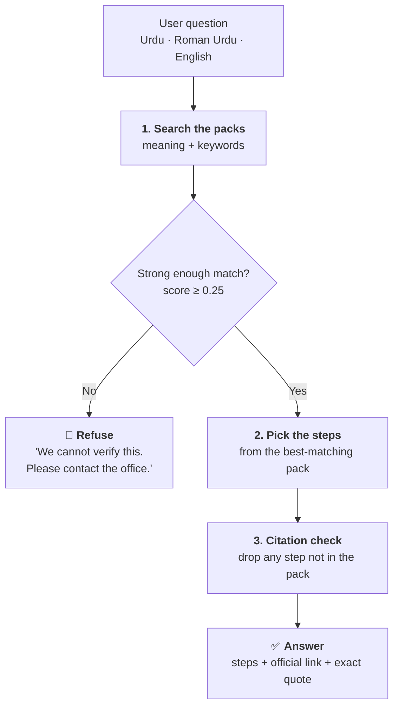

# Haqdar AI: how it works and how well it works

> **In one line:** Haqdar answers questions about official procedures **only from verified government sources**, and **refuses** when it cannot verify an answer.

**Owner:** Malaika Khan, Data Science and AI Lead
**Code:** `backend/ai/` · **Packs:** `packs/` · **Evaluation:** `eval/`

---

## Results at a glance

| | Result |
|---|:---:|
| ✅ Correct answers | **25 / 25** (100%) |
| 📎 Answers with a correct official source | **25 / 25** (100%) |
| 🛑 Out-of-scope questions safely refused | **9 / 10** (90%) |
| ⚠️ Real questions wrongly refused | **0 / 25** (0%) |

Tested in **Urdu**, **Roman Urdu** and **English** on 35 questions. See [Limitations](#limitations) before reading too much into these numbers.

---

## How a question is answered



**Why this is safe:** Haqdar never writes its own steps. It only shows steps that already exist in a pack, and each one comes with its source. In this mode nothing is sent outside the server.

---

## The modules

| Module | What it does in plain words |
|---|---|
| **K1 · Pack loader** | Reads the procedure packs and rejects any step without a valid official source |
| **K2 · Search** | Finds the right steps by meaning *and* by keywords (keywords help with Roman Urdu) |
| **K3 · Answers** | Builds the answer only from verified steps, or refuses |
| **K5 · Scam check** | Spots pressure tactics: urgency, threats, Easypaisa/JazzCash requests, OTP/PIN requests, fake prizes |
| **K7 · Evaluation** | Measures everything on this page |

---

## Procedure packs

| Pack | Steps | Official source |
|---|:---:|---|
| ⚡ Disputing an electricity bill | 8 | NEPRA Consumer Service Manual 2020 |
| 🧾 Replying to an FBR tax notice | 7 | FBR IRIS FAQ, FBR Taxpayer's Facilitation Guide |

Every quote was checked **word for word** in the official PDF before it was added.

---

## Results by language

| Language | Correct answers | Safely refused |
|---|:---:|:---:|
| Urdu | 8 / 8 | 2 / 2 |
| Roman Urdu | 10 / 10 | 5 / 5 |
| English | 7 / 7 | 2 / 3 |

**Confidence:** correct answers average **0.54**; out-of-scope questions average **0.11**. The clear gap is what makes refusing safe.

<details>
<summary><b>How we chose the 0.25 threshold</b> (click to open)</summary>

| Threshold | Correct answers | Safely refused |
|:---:|:---:|:---:|
| 0.15 | 100% | 60% |
| 0.20 | 100% | 80% |
| **0.25** | **100%** | **90%** |
| 0.30 | 92% | 90% |
| 0.35 | 84% | 100% |

Higher refuses real questions. Lower answers questions it should not. 0.25 is the best balance.

</details>

<details>
<summary><b>What the test set contains</b> (click to open)</summary>

- **25 answerable questions:** 8 Urdu, 10 Roman Urdu, 7 English
- **10 out-of-scope questions:** passport, CNIC renewal, weather, a poem...
- **Trick questions on purpose:** a *gas* bill question (sounds like electricity) and a *tax rate* question (sounds like FBR)
- **4 held-out questions:** written *after* tuning, to make sure we did not tune to the test

</details>

---

## What we learned

| | What happened | What we did |
|---|---|---|
| 1 | *"meter check karwane mein kitne din lagte hain"* was wrongly refused | Added Roman Urdu keywords to each step |
| 2 | *"gas ka bill zyada aya hai"* got electricity steps | Added a scope guard: packs skip questions about other services |
| 3 | *"How much income tax do I pay on my salary?"* got FBR filing steps instead of a refusal | **Kept as a known failure.** Patching it would mean tuning to the test. Future work: check the question's intent first |

---

## Limitations

- 🔬 **Small test set** (35 questions) written by our own team. Real-world results will be lower.
- 📦 **Only two packs.** Everything else is refused: safe, but limited.
- 📅 **Sources can go out of date.** NEPRA published a 2025 manual; we left out FBR penalty amounts because our only source was from 2014.
- 🧪 **The scam check** learned from 40 made-up examples. It is one warning signal, not a verdict.
- ⚖️ **Not legal advice.** For anything serious, Haqdar points users to the official office.

---

## Run it yourself

```bash
pip install -r backend/requirements.txt -r backend/ai/requirements.txt
python eval/run_eval.py              # full report → eval/results.md
cd backend && pytest tests ai -v     # all unit tests
```
